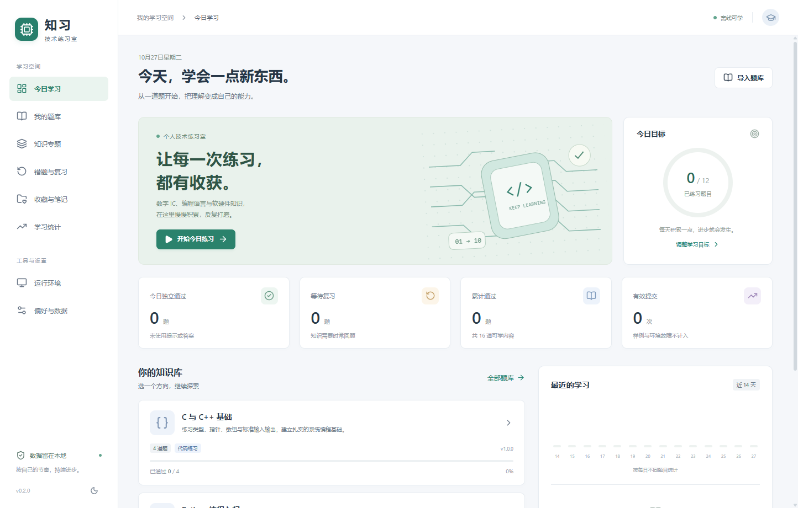
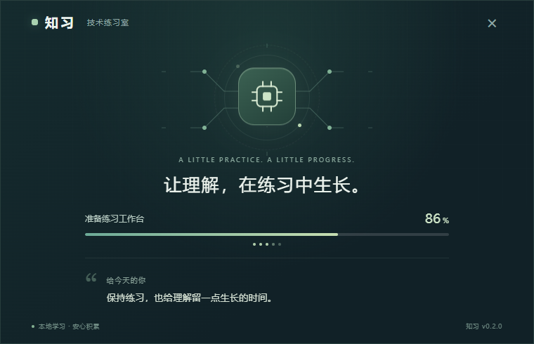

# 知习 · 技术练习室

个人数字 IC、Verilog、Python 和 C/C++ 刷题桌面软件。当前版本 **0.2.0**，使用 Electron、React、TypeScript、Monaco 和 SQLite，学习数据保存在本机。



## 功能

- 单选、多选、判断题即时判分；编程/RTL 题支持代码编辑、样例运行、正式评测、日志及 VCD 导出。
- Python、C11、C++17 和基础 Verilog-2005 运行适配器，可使用本机工具或 Docker。
- QBank 1.0 JSON/ZIP 导入、格式和语义校验、版本与历史；配套 AI 出题提示词和 qbank-generator 技能。
- 错题复习、收藏、笔记、草稿自动保存、学习统计、CSV 导出和备份恢复。
- Windows exe 启动器、按实际初始化阶段更新的进度，以及 24 条本地轮换学习寄语。



## 从源码运行

需要 Node.js 24、npm 和 Windows。Windows 启动器使用系统自带的 .NET Framework C# 编译器构建。

```powershell
cd tech-practice
npm ci
npm run prepare:assets
npm test
npm run build
npm start
```

prepare:assets 从 npm 依赖生成 sql.js 的 WASM，并准备内置题库。Git 仓库不携带下载的 Python、Icarus、GTKWave、Electron 运行库或个人学习数据库；npm ci 会按锁文件安装依赖并下载 Electron。

Python 练习可在「运行环境」选择已安装的 Python；也可从 [Python 官方](https://www.python.org/downloads/windows/)获取 Windows embeddable 包，完整解压到 tech-practice/assets/python/ 并保留许可证。Verilog 需要 iverilog.exe 和 vvp.exe；C/C++ 需要对应编译器，环境页可指定路径。

## 构建 Windows 程序

```powershell
cd tech-practice
npm run package
```

输出位于 tech-practice/release/TechPractice-win32-x64/，双击其中的知习.exe。仓库根目录也会生成入口知习.exe，须与 tech-practice 文件夹保留当前相对位置。

更新资源后，正常退出旧窗口再打开新入口。学习数据库沿用 %APPDATA%/TechPractice，与程序目录分开。

## 题库与文档

- [Verilog 时序逻辑 200 题](题库/Verilog时序逻辑200题.qbank.json)：100 单选、40 多选、40 判断、20 RTL，源码与测试均内联，直接导入 JSON。
- [QBank 协议与示例](题库协议与示例/)：Schema、AI 出题提示词、完整示例。
- [qbank-generator 技能](skills/qbank-generator/SKILL.md)：生成、校验、修复及增量更新题库。
- [功能设计文档](docs/个人技术刷题软件功能设计文档.md)。
- [启动功能测试报告](tech-practice/STARTUP_TEST_REPORT.md)。

结构校验不等于知识内容的完整正确性，请结合解析和实际测试学习。

## 验证

```powershell
cd tech-practice
npm test
npm run test:startup
npm run test:ui
```

启动/桌面测试需要可运行 Electron 的 Windows 桌面，使用独立数据库和 Chromium profile。构建产物、下载缓存和个人学习数据已加入 .gitignore。

## 双仓库同步

本项目同步维护于 [Gitee](https://gitee.com/zhang-xinyou/wisdom-cultivator) 与 [GitHub](https://github.com/zhangxinyou-cameron/-)。

首次克隆后，在仓库根目录运行以下命令配置同步推送（本地 Git 配置不会随克隆复制）：

```powershell
.\scripts\Sync-Repositories.ps1 -ConfigureOnly
```

请在本地 main/master 分支上配置同步。之后正常提交并执行 `git push`，会将该本地主分支推送到两个平台的 main 和 master，保持默认分支内容一致。也可以运行 `.\scripts\Sync-Repositories.ps1` 完成推送及远程提交核验。映射固定到本地主分支，切换到特性分支不会将其意外覆盖到远程默认分支。两个平台的写入权限分别使用本机 Git 凭据；不要把密码或访问令牌写入仓库。

推送遇到远程新提交时，先拉取整合再重试。跨平台推送不具有原子性，脚本会在失败时报告并停止，成功后核对四个分支均指向当前提交。

## 目录

```text
tech-practice/       应用源码、资源、测试、启动器和构建脚本
docs/               功能设计、使用补充和界面预览
题库/               可导入的学习题库
题库协议与示例/      QBank 1.0 Schema、提示词和示例
skills/             qbank-generator 技能
```

本机模式以当前账户权限运行代码；隔离和资源限制依赖容器后端，详见软件内环境说明。功能仿真不代替综合、CDC 检查或实现后 STA。

第三方依赖按各自许可证使用，见 [THIRD_PARTY_NOTICES](tech-practice/assets/THIRD_PARTY_NOTICES.txt)。
